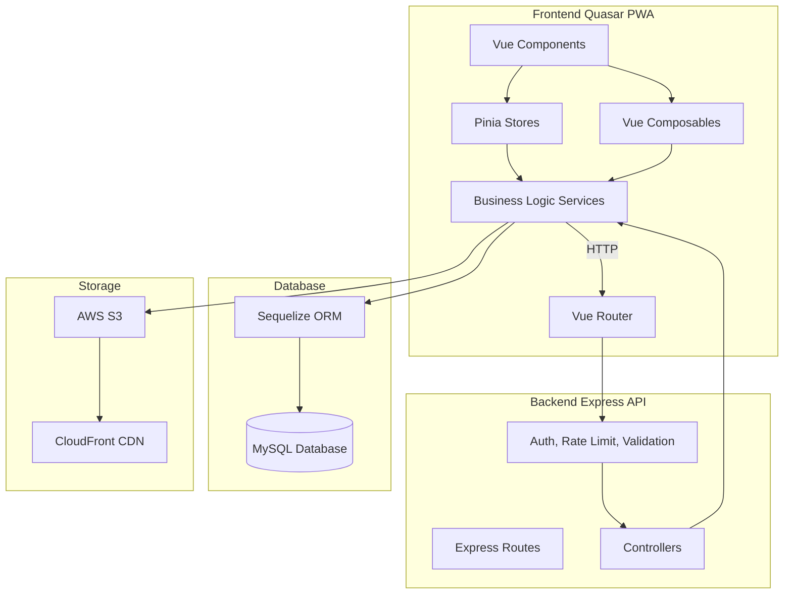
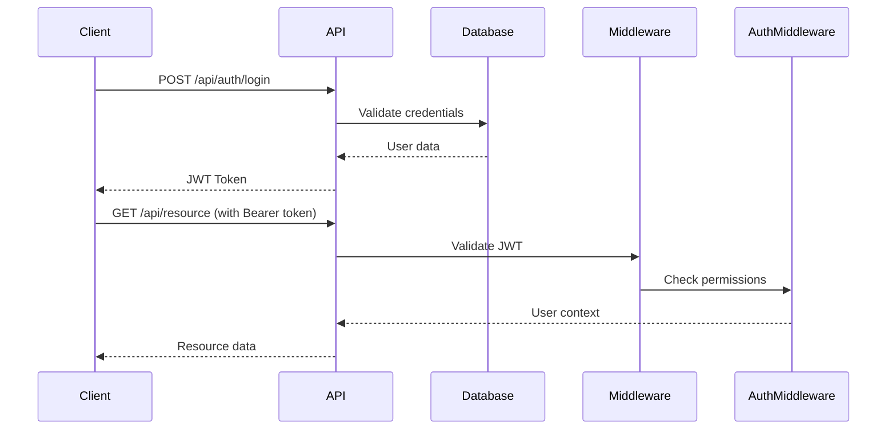

# BTC Learning Platform - Module Documentation

## Overview

BTC Learning Platform is a full-stack educational application with:
- **Frontend**: Quasar PWA (Vue 3) with Pinia state management
- **Backend**: Express.js API with Sequelize ORM
- **Storage**: S3/CloudFront for video content
- **Database**: MySQL/SQLite with Sequelize models

---

## Project Structure

```
btc/
├── frontend/                 # Quasar PWA Application
│   ├── src/
│   │   ├── boot/            # App initialization (axios, auth, i18n, filters)
│   │   ├── components/      # Reusable Vue components
│   │   ├── composables/     # Vue composables for reusable logic
│   │   ├── layouts/         # App layouts (MainLayout, GuestLayout)
│   │   ├── pages/           # Page components
│   │   ├── services/        # API and utility services
│   │   ├── stores/          # Pinia stores
│   │   └── i18n/            # Internationalization
├── nodejs-express-api/       # Express.js Backend
│   ├── controllers/         # Route controllers
│   ├── models/              # Sequelize models
│   ├── routes/              # Route definitions
│   ├── middleware/          # Custom middleware
│   ├── helpers/             # Utility helpers
│   └── services/            # Business logic services
└── docs/                    # Documentation
```

---

## Backend Modules (Express.js)

### Controllers

#### Core Educational Modules

| Module | Controller File | Purpose |
|--------|-----------------|---------|
| **LearningLevels** | [`controllers/learninglevels.js`](../nodejs-express-api/controllers/learninglevels.js) | Manage learning levels (e.g., Grade 1, Grade 2) |
| **Grades** | [`controllers/grades.js`](../nodejs-express-api/controllers/grades.js) | Manage grade levels linked to learning levels |
| **LearningAreas** | [`controllers/learningareas.js`](../nodejs-express-api/controllers/learningareas.js) | Manage learning areas/subjects |
| **Topics** | [`controllers/topics.js`](../nodejs-express-api/controllers/topics.js) | Manage topics within learning areas |
| **Subtopics** | [`controllers/subtopics.js`](../nodejs-express-api/controllers/subtopics.js) | Manage subtopics within topics |
| **Lessons** | [`controllers/lessons.js`](../nodejs-express-api/controllers/lessons.js) | Manage lesson content and video streaming |

#### Subscription & User Management

| Module | Controller File | Purpose |
|--------|-----------------|---------|
| **Users** | [`controllers/users.js`](../nodejs-express-api/controllers/users.js) | User authentication and management |
| **Auth** | [`controllers/auth.js`](../nodejs-express-api/controllers/auth.js) | Authentication endpoints |
| **Subscriptions** | [`controllers/subscriptions.js`](../nodejs-express-api/controllers/subscriptions.js) | Subscription management |
| **ActiveSubscriptions** | [`controllers/activesubscriptions.js`](../nodejs-express-api/controllers/activesubscriptions.js) | View active subscriptions |
| **ExpiredSubscriptions** | [`controllers/expiredsubscriptions.js`](../nodejs-express-api/controllers/expiredsubscriptions.js) | View expired subscriptions |
| **SubscriptionTypes** | [`controllers/subscriptiontypes.js`](../nodejs-express-api/controllers/subscriptiontypes.js) | Subscription type definitions |
| **Packages** | [`controllers/packages.js`](../nodejs-express-api/controllers/packages.js) | Package management |
| **Roles** | [`controllers/roles.js`](../nodejs-express-api/controllers/roles.js) | Role definitions (admin, subscriber, teacher, marketer) |

#### Content & Media

| Module | Controller File | Purpose |
|--------|-----------------|---------|
| **Videos** | [`controllers/videos.js`](../nodejs-express-api/controllers/videos.js) | Video metadata management |
| **FileUploader** | [`controllers/fileuploader.js`](../nodejs-express-api/controllers/fileuploader.js) | File upload handling |
| **S3Uploader** | [`controllers/s3uploader.js`](../nodejs-express-api/controllers/s3uploader.js) | S3 cloud upload |
| **ComponentsData** | [`controllers/components_data.js`](../nodejs-express-api/controllers/components_data.js) | Dynamic component data |

#### User Activity & Tracking

| Module | Controller File | Purpose |
|--------|-----------------|---------|
| **LessonTrack** | [`controllers/lessontrack.js`](../nodejs-express-api/controllers/lessontrack.js) | Track user lesson progress |
| **SubscriberTracker** | [`controllers/subscribertracker.js`](../nodejs-express-api/controllers/subscribertracker.js) | Track subscriber activity |
| **GuestTracker** | [`controllers/guesttracker.js`](../nodejs-express-api/controllers/guesttracker.js) | Track guest user activity |
| **UserActivity** | [`controllers/useractivity.js`](../nodejs-express-api/controllers/useractivity.js) | General user activity logs |
| **LessonAccessLogs** | `models/lessonaccesslogs.js` | Detailed lesson access logs |

#### Administrative Modules

| Module | Controller File | Purpose |
|--------|-----------------|---------|
| **AboutUs** | [`controllers/aboutus.js`](../nodejs-express-api/controllers/aboutus.js) | About page content |
| **ContactUs** | [`controllers/contactus.js`](../nodejs-express-api/controllers/contactus.js) | Contact form submissions |
| **NewsletterSubscribers** | [`controllers/newslettersubscribers.js`](../nodejs-express-api/controllers/newslettersubscribers.js) | Newsletter management |
| **Purchases** | [`controllers/purchases.js`](../nodejs-express-api/controllers/purchases.js) | Purchase history |
| **Transactions** | [`controllers/transactions.js`](../nodejs-express-api/controllers/transactions.js) | Transaction records |
| **Questions** | [`controllers/questions.js`](../nodejs-express-api/controllers/questions.js) | Q&A management |
| **UserGuide** | [`controllers/userguide.js`](../nodejs-express-api/controllers/userguide.js) | User guide content |

#### Reporting & Analytics

| Module | Controller File | Purpose |
|--------|-----------------|---------|
| **MonthlySubscriptionSummary** | [`controllers/monthlysubscriptionsummary.js`](../nodejs-express-api/controllers/monthlysubscriptionsummary.js) | Monthly subscription reports |
| **SubscriptionsByType** | [`controllers/subscriptionsbytype.js`](../nodejs-express-api/controllers/subscriptionsbytype.js) | Subscription breakdown by type |
| **SubscriptionsPerUser** | [`controllers/subscriptionsperuser.js`](../nodejs-express-api/controllers/subscriptionsperuser.js) | Per-user subscription data |
| **SubscriptionsRenewal** | [`controllers/subscriptionsrenewal.js`](../nodejs-express-api/controllers/subscriptionsrenewal.js) | Renewal tracking |
| **SubscriptionStatusDistribution** | [`controllers/subscriptionstatusdistribution.js`](../nodejs-express-api/controllers/subscriptionstatusdistribution.js) | Status distribution analytics |

#### Other Modules

| Module | Controller File | Purpose |
|--------|-----------------|---------|
| **Account** | [`controllers/account.js`](../nodejs-express-api/controllers/account.js) | User account management |
| **AssignRights** | [`controllers/assignrights.js`](../nodejs-express-api/controllers/assignrights.js) | Permission assignment |
| **GuestUsers** | [`controllers/guestusers.js`](../nodejs-express-api/controllers/guestusers.js) | Guest user management |
| **Invites** | [`controllers/invites.js`](../nodejs-express-api/controllers/invites.js) | Invitation system |
| **Marketers** | [`controllers/marketers.js`](../nodejs-express-api/controllers/marketers.js) | Marketer management |
| **Permissions** | [`controllers/permissions.js`](../nodejs-express-api/controllers/permissions.js) | Permission definitions |
| **Rightslist** | [`controllers/rightslist.js`](../nodejs-express-api/controllers/rightslist.js) | Rights list management |
| **Scheduler** | [`controllers/scheduler.js`](../nodejs-express-api/controllers/scheduler.js) | Scheduled tasks |
| **ServicesSettings** | [`controllers/servicessettings.js`](../nodejs-express-api/controllers/servicessettings.js) | Service configurations |
| **TutorialRegister** | [`controllers/tutorialregister.js`](../nodejs-express-api/controllers/tutorialregister.js) | Tutorial registration |
| **TutorialsSettings** | [`controllers/tutorialssettings.js`](../nodejs-express-api/controllers/tutorialssettings.js) | Tutorial settings |
| **MigrationRoutes** | [`controllers/migrationroutes.js`](../nodejs-express-api/controllers/migrationroutes.js) | Data migration routes |
| **S3Sync** | [`controllers/s3SyncController.js`](../nodejs-express-api/controllers/s3SyncController.js) | S3 synchronization |

### API Endpoints Pattern

Most controllers follow this RESTful pattern:

```
GET    /api/{resource}              # List records (paginated)
GET    /api/{resource}/index/:fieldname?/:fieldvalue?  # Filtered list
GET    /api/{resource}/view/:recid  # View single record
GET    /api/{resource}/edit/:recid  # Get record for editing
POST   /api/{resource}/add          # Create new record
POST   /api/{resource}/edit/:recid  # Update record
GET    /api/{resource}/delete/:recid # Delete record(s)
```

### Database Models

#### Core Models

| Model | File | Relationships |
|-------|------|---------------|
| **LearningLevels** | [`models/learninglevels.js`](../nodejs-express-api/models/learninglevels.js) | hasMany Grades |
| **Grades** | [`models/grades.js`](../nodejs-express-api/models/grades.js) | belongsTo LearningLevels, hasMany LearningAreas |
| **LearningAreas** | [`models/learningareas.js`](../nodejs-express-api/models/learningareas.js) | belongsTo Grades, hasMany Lessons |
| **Topics** | [`models/topics.js`](../nodejs-express-api/models/topics.js) | hasMany Subtopics, hasMany Lessons |
| **Subtopics** | [`models/subtopics.js`](../nodejs-express-api/models/subtopics.js) | belongsTo Topics, hasMany Lessons |
| **Lessons** | [`models/lessons.js`](../nodejs-express-api/models/lessons.js) | belongsTo LearningAreas, Topics, Subtopics, hasMany Videos, Purchases |

#### User & Subscription Models

| Model | File | Relationships |
|-------|------|---------------|
| **Users** | [`models/users.js`](../nodejs-express-api/models/users.js) | belongsTo Roles, hasMany Subscriptions, Purchases |
| **Roles** | [`models/roles.js`](../nodejs-express-api/models/roles.js) | Users (admin, subscriber, teacher, marketer) |
| **Subscriptions** | [`models/subscriptions.js`](../nodejs-express-api/models/subscriptions.js) | belongsTo Users, SubscriptionTypes |
| **SubscriptionTypes** | [`models/subscriptiontypes.js`](../nodejs-express-api/models/subscriptiontypes.js) | hasMany Subscriptions |
| **Packages** | [`models/packages.js`](../nodejs-express-api/models/packages.js) | Used in LessonTrack |
| **Purchases** | [`models/purchases.js`](../nodejs-express-api/models/purchases.js) | belongsTo Users, Lessons |

#### Tracking Models

| Model | File | Relationships |
|-------|------|---------------|
| **LessonTrack** | [`models/lessontrack.js`](../nodejs-express-api/models/lessontrack.js) | belongsTo Subscriptions, Packages |
| **LessonAccessLogs** | [`models/lessonaccesslogs.js`](../nodejs-express-api/models/lessonaccesslogs.js) | belongsTo Users, Lessons, GuestTracker, LessonTrack |
| **SubscriberTracker** | [`models/subscribertracker.js`](../nodejs-express-api/models/subscribertracker.js) | Activity tracking |
| **GuestTracker** | [`models/guesttracker.js`](../nodejs-express-api/models/guesttracker.js) | Guest user tracking |

---

## Frontend Modules (Quasar PWA)

### Services

| Service | File | Purpose |
|---------|------|---------|
| **ApiService** | [`services/api.js`](../frontend/src/services/api.js) | Axios wrapper with caching support |
| **StorageService** | [`services/storage.js`](../frontend/src/services/storage.js) | Token and data storage management |
| **PhoneValidator** | [`services/phone-validator.js`](../frontend/src/services/phone-validator.js) | Phone number validation |
| **Validators** | [`services/validators.js`](../frontend/src/services/validators.js) | Form validation utilities |

### Pinia Stores

| Store | File | Purpose |
|-------|------|---------|
| **useAuthStore** | [`stores/auth.js`](../frontend/src/stores/auth.js) | Authentication state (user, token, login/logout) |
| **useAppStore** | [`stores/app.js`](../frontend/src/stores/app.js) | App-wide state (dialogs, loading, notifications) |
| **usePageStore** | [`stores/page.js`](../frontend/src/stores/page.js) | Dynamic page state management |
| **useLearningHierarchyStore** | [`stores/learningHierarchyStore.js`](../frontend/src/stores/learningHierarchyStore.js) | Learning hierarchy (levels, grades, areas, lessons) |
| **useGuestStore** | [`stores/guestStore.js`](../frontend/src/stores/guestStore.js) | Guest user state and fingerprinting |
| **useSubscribedStore** | [`stores/subscribedStore.js`](../frontend/src/stores/subscribedStore.js) | Subscriber-specific state |
| **useActiveSessionsStore** | [`stores/activeSessionsStore.js`](../frontend/src/stores/activeSessionsStore.js) | Active session management |

### Composables

#### Page Composables

| Composable | File | Purpose |
|------------|------|---------|
| **useListPage** | [`composables/listpage.js`](../frontend/src/composables/listpage.js) | List page functionality (pagination, filtering, sorting) |
| **useViewPage** | [`composables/viewpage.js`](../frontend/src/composables/viewpage.js) | View page functionality (single record display) |
| **useAddPage** | [`composables/addpage.js`](../frontend/src/composables/addpage.js) | Add page functionality (form submission) |
| **useEditPage** | [`composables/editpage.js`](../frontend/src/composables/editpage.js) | Edit page functionality (form updates) |
| **useFormPage** | [`composables/formpage.js`](../frontend/src/composables/formpage.js) | Generic form handling |
| **useApp** | [`composables/app.js`](../frontend/src/composables/app.js) | App utilities (notifications, dialogs, errors) |
| **useAuth** | [`composables/auth.js`](../frontend/src/composables/auth.js) | Authentication helpers |

#### Video Composables

| Composable | File | Purpose |
|------------|------|---------|
| **useVideoStream** | [`composables/useVideoStream.js`](../frontend/src/composables/useVideoStream.js) | Fetch and manage video stream URLs |
| **useVideoSession** | [`composables/useVideoSession.js`](../frontend/src/composables/useVideoSession.js) | Manage video session lifecycle |
| **useVideoQuality** | [`composables/useVideoQuality.js`](../frontend/src/composables/useVideoQuality.js) | Video quality selection and switching |
| **useConnectionQuality** | [`composables/useConnectionQuality.js`](../frontend/src/composables/useConnectionQuality.js) | Monitor and adapt to connection quality |

### Components

#### Video Components

| Component | File | Purpose |
|-----------|------|---------|
| **CustomVideoPlayer** | [`components/CustomVideoPlayer.vue`](../frontend/src/components/CustomVideoPlayer.vue) | Custom video player with controls |
| **SmartVideoPlayer** | [`components/SmartVideoPlayer.vue`](../frontend/src/components/SmartVideoPlayer.vue) | Intelligent video player with quality switching |
| **SubscriberWatchVideo** | [`components/SubscriberWatchVideo.vue`](../frontend/src/components/SubscriberWatchVideo.vue) | Subscriber-specific video player |
| **ConnectionIndicator** | [`components/video/ConnectionIndicator.vue`](../frontend/src/components/video/ConnectionIndicator.vue) | Show connection quality |
| **QualitySelector** | [`components/video/QualitySelector.vue`](../frontend/src/components/video/QualitySelector.vue) | Video quality selector dropdown |
| **LoadingOverlay** | [`components/video/LoadingOverlay.vue`](../frontend/src/components/video/LoadingOverlay.vue) | Video loading indicator |
| **ErrorState** | [`components/video/ErrorState.vue`](../frontend/src/components/video/ErrorState.vue) | Video error display |
| **SessionWarning** | [`components/video/SessionWarning.vue`](../frontend/src/components/video/SessionWarning.vue) | Session expiry warning |
| **SessionExpired** | [`components/video/SessionExpired.vue`](../frontend/src/components/video/SessionExpired.vue) | Session expired state |
| **LessonInfo** | [`components/video/LessonInfo.vue`](../frontend/src/components/video/LessonInfo.vue) | Show lesson information |
| **UsageStats** | [`components/video/UsageStats.vue`](../frontend/src/components/video/UsageStats.vue) | Display usage statistics |

#### Common Components

| Component | File | Purpose |
|-----------|------|---------|
| **WatchVideo** | [`components/WatchVideo.vue`](../frontend/src/components/WatchVideo.vue) | Main video watching component |
| **VideoList** | [`components/VideoList.vue`](../frontend/src/components/VideoList.vue) | List of videos |
| **FileViewer** | [`components/FileViewer.vue`](../frontend/src/components/FileViewer.vue) | View files |
| **ImageViewer** | [`components/ImageViewer.vue`](../frontend/src/components/ImageViewer.vue) | View images |
| **FullQEditor** | [`components/FullQEditor.vue`](../frontend/src/components/FullQEditor.vue) | Rich text editor |
| **QUploaderInput** | [`components/QUploaderInput.vue`](../frontend/src/components/QUploaderInput.vue) | File upload component |
| **PageSearch** | [`components/PageSearch.vue`](../frontend/src/components/PageSearch.vue) | Search functionality |
| **FilterTags** | [`components/FilterTags.vue`](../frontend/src/components/FilterTags.vue) | Filter tags UI |
| **NiceSelect** | [`components/NiceSelect.vue`](../frontend/src/components/NiceSelect.vue) | Custom select dropdown |
| **Calendar** | [`components/Calendar.vue`](../frontend/src/components/Calendar.vue) | Calendar component |
| **CountdownTimer** | [`components/CountdownTimer.vue`](../frontend/src/components/CountdownTimer.vue) | Countdown display |
| **MpesaPayment** | [`components/MpesaPayment.vue`](../frontend/src/components/MpesaPayment.vue) | M-Pesa payment integration |
| **PhoneVerification** | [`components/PhoneVerification.vue`](../frontend/src/components/PhoneVerification.vue) | Phone verification |

### Pages

#### Custom Pages

| Page | File | Purpose |
|------|------|---------|
| **Home** | [`pages/custom/advanced.vue`](../frontend/src/pages/custom/advanced.vue) | Advanced home page |
| **Basic** | [`pages/custom/basic.vue`](../frontend/src/pages/custom/basic.vue) | Basic home page |
| **Collections** | [`pages/custom/collections.vue`](../frontend/src/pages/custom/collections.vue) | Learning collections |
| **Lessons** | [`pages/custom/lessons.vue`](../frontend/src/pages/custom/lessons.vue) | Browse lessons |
| **SubscribedWatching** | [`pages/custom/subscribedwatching.vue`](../frontend/src/pages/custom/subscribedwatching.vue) | Video player for subscribers |
| **GuestWatching** | [`pages/custom/guestwatching.vue`](../frontend/src/pages/custom/guestwatching.vue) | Video player for guests |
| **Login** | [`pages/custom/login.vue`](../frontend/src/pages/custom/login.vue) | User login |
| **Subscribe** | [`pages/custom/subscribe.vue`](../frontend/src/pages/custom/subscribe.vue) | Subscription page |
| **Packages** | [`pages/custom/packages.vue`](../frontend/src/pages/custom/packages.vue) | View packages |
| **Contact** | [`pages/custom/contact.vue`](../frontend/src/pages/custom/contact.vue) | Contact page |
| **Guide** | [`pages/custom/guide.vue`](../frontend/src/pages/custom/guide.vue) | User guide |
| **About** | [`pages/custom/about.vue`](../frontend/src/pages/custom/about.vue) | About page |

---

## Architecture Diagram



---

## Authentication Flow



---

## Learning Hierarchy

```
LearningLevels (e.g., Primary, Secondary)
├── Grades (e.g., Grade 1, Grade 2, Grade 3)
│   └── LearningAreas (e.g., Mathematics, English, Kiswahili)
│       └── Topics (e.g., Numbers, Addition, Subtraction)
│           └── Subtopics (e.g., Whole Numbers, Fractions)
│               └── Lessons (e.g., "Introduction to Fractions")
│                   └── Videos (Lesson video content)
```

---

## Optimization Areas

Based on the current structure, potential optimization areas include:

1. **Caching Strategy**
   - Implement Redis caching for frequently accessed data
   - Add response caching in Express with `apicache`

2. **Database Optimization**
   - Add database indexes on frequently queried columns
   - Implement query optimization with eager loading
   - Consider connection pooling

3. **Frontend Performance**
   - Code splitting and lazy loading
   - Optimize bundle size with tree shaking
   - Implement proper PWA caching strategies

4. **Video Streaming**
   - Adaptive bitrate streaming (HLS/DASH)
   - CDN optimization
   - Video preloading strategies

5. **API Optimization**
   - Rate limiting optimization
   - Response compression
   - API version management

6. **Security Enhancements**
   - CSRF protection
   - Input validation enhancement
   - Rate limiting fine-tuning

---

## Dependencies Summary

### Backend
- `express` - Web framework
- `sequelize` - ORM
- `passport-jwt` - Authentication
- `cors` - Cross-origin resource sharing
- `compression` - Response compression
- `aws-sdk` - AWS integration
- `multer` - File uploads

### Frontend
- `quasar` - UI framework
- `vue` - Vue 3
- `pinia` - State management
- `axios` - HTTP client with caching
- `vue-i18n` - Internationalization
- `@quasar/extras` - Quasar icons and fonts
